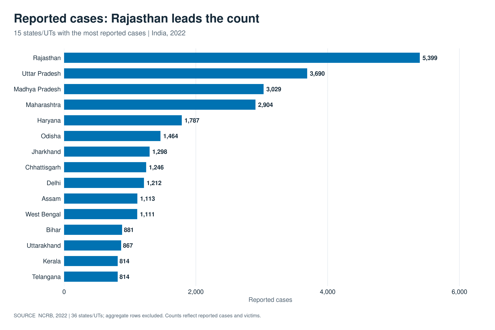

# Rape victims in India, 2022: analysis in R

[](https://github.com/Ctrlm0nster/Crime_Victims_analysis_in_India_2022_using_R/actions/workflows/r-analysis.yml)

An analysis of NCRB data on reported rape cases and victims across India's **28 states and 8 union territories**. The project validates the source records, calculates descriptive statistics, and produces charts showing case counts, victim ages, and the share of child victims.

[View the six-chart PDF](Result/CSV/plots/CSV_Generated_Plots.pdf) · [Read the analysis report](Result/CSV/reports/ncrb_analysis_report_2022.txt) · [Download the cleaned CSV](Result/CSV/data/ncrb_rape_data_2022_cleaned.csv)



## Findings

| Measure | 2022 total |
| --- | ---: |
| Reported cases | 31,516 |
| Victims | 31,982 |
| Child victims, under 18 | 1,017 |
| Adult victims, 18 and older | 30,965 |
| Children as a share of all victims | 3.18% |
| Average reported cases per state/UT | 875.44 |

Rajasthan recorded the highest case count (5,399), followed by Uttar Pradesh (3,690) and Madhya Pradesh (3,029). Victims aged 18 to under 30 accounted for 21,063 victims, or 65.86% of the total.

**Cases and victims are separate measures:** a case can involve more than one victim. These figures summarize reported records. Differences in population and reporting practices affect comparisons between jurisdictions.

## Run the project

Use **R 4.1 or newer** and **ggplot2 3.4 or newer**. Run all commands from the project root. You can open the `.Rproj` file in RStudio or use R from a terminal.

### One-command workflow

```sh
Rscript run.R
```

This checks installed package versions against `renv.lock`, runs data validation and offline XML fixture tests, generates the CSV charts and report, and verifies the new artifacts. It refreshes population context and leaves saved XML results in place.

For a fresh setup, install `renv` once and restore the pinned versions:

```r
install.packages("renv")
```

```sh
Rscript run.R --restore
```

Dependencies are restored to the ignored `renv/library/` directory. Restore may download packages and require system build tools. The lockfile records the tested R version as well as package versions; `renv` does not install R itself. Starting R does not automatically restore packages.

To include a live API comparison, configure `GOV_API_KEY` as described below, then run:

```sh
Rscript run.R --live
# Or restore dependencies and run the live check together:
Rscript run.R --restore --live
```

The live command validates all fetched records and compares them with the local CSV before regenerating either analysis report. If the key is missing, it stops before starting the workflow. A failed request or data mismatch fails the command; fixture tests are reported separately from the live check. The live check passed on 18 November 2026: all 36 jurisdiction records matched the local CSV.

The individual scripts below remain available when you want to run one step.

### Analyze the local CSV

Install the plotting dependencies once in R:

```r
install.packages(c("dplyr", "tidyr", "readr", "purrr", "ggplot2", "scales"))
```

Then run:

```sh
Rscript Scripts/Analysis_Script_CSV.R
Rscript Scripts/Cleaning_data.R
```

The first command writes the cleaned data, report, charts, and PDF to `Result/CSV/`. The second adds the population-context CSV. Both workflows use the supplied local inputs and run offline after dependencies are installed.

### Fetch and analyze XML data

Install the additional API dependencies in R:

```r
install.packages(c("httr2", "xml2"))
```

Add your data.gov.in API key to a local `.Renviron` file:

```dotenv
GOV_API_KEY=your_api_key_here
```

The repository ignores `.Renviron`. Start a new R session after creating or editing it, then run:

```sh
Rscript Scripts/Analysis_Script_XML.R
```

This workflow fetches paginated XML records, checks completeness, and writes results to `Result/XML/`. To save the fetched records as intermediate RDS files as well, run:

```sh
Rscript Scripts/Loading_data.R
```

The loading script writes to `Data/intermediate/`. These intermediate files are optional for the local CSV analysis.

**Saved XML results:** the `Result/XML/` artifacts were regenerated from live API data on 18 November 2026. All 36 jurisdiction records matched the local CSV, and the output checks passed for both workflows.

## Explore the results

All charts are available as 300-DPI PNGs and in a six-page PDF.

| Chart | What it shows |
| --- | --- |
| [Reported cases](Result/CSV/plots/plot1_top15_states_cases.png) | The 15 states/UTs with the highest reported case counts |
| [Adult and child victims](Result/CSV/plots/plot2_child_vs_adult_victims.png) | Separate panels for the 15 states/UTs with the most victims; each panel uses its own count scale |
| [National age distribution](Result/CSV/plots/plot3_age_distribution_india.png) | Counts and percentages across eight age groups |
| [Child victim shares](Result/CSV/plots/plot4_child_victim_percentage.png) | Percentages and underlying counts for jurisdictions reporting child victims |
| [Case volume groups](Result/CSV/plots/plot5_case_volume_categories.png) | How many states/UTs fall into each case-count range |
| [Age profiles](Result/CSV/plots/plot6_age_breakdown_top10.png) | A labeled heatmap for the 10 states/UTs with the highest case counts |

Charts use blue and dark orange, direct labels, and consistent ordering so readers can understand them without relying on color alone. Heatmap labels switch between black and white to maintain at least **4.5:1 text contrast** against their cells.

The [dashboard summary](Result/CSV/data/dashboard_summary.rds) contains overall metrics, the top five jurisdictions, age totals, and case volume groups. Load it in R with:

```r
summary <- readRDS("Result/CSV/data/dashboard_summary.rds")
summary$key_metrics
```

## Data and method

The primary source is NCRB's *State/UT-wise Number of Women and Girls Victims of Rape during 2022*, distributed through data.gov.in resource `0a096e81-5a1b-4e23-9f28-1abd1db76d16`.

The supplied [source CSV](Data/raw/NCRB_DATA.3.csv) has 40 rows: 36 jurisdictions, state and UT subtotals, an all-India total, and an age-group percentage row. Only the 36 individual jurisdictions enter calculations and rankings.

CSV and XML inputs use `Scripts/Common.R` as a short entry point that loads the shared data, analysis, and plotting modules. Validation checks column names, unique serial numbers and jurisdictions, complete coverage, nonnegative integer counts, and agreement between age-group counts and victim totals. Calculations include totals, averages, percentages, and rankings. The project performs no predictive modeling or causal inference.

### Population context

The [population-context CSV](Result/CSV/data/ncrb_population_context_2022.csv) joins the supplied [2011 census population table](Data/raw/India_State_population_2011_census.csv) to the 2022 records.

Delhi is matched to NCT of Delhi, and the former Dadra and Nagar Haveli and Daman and Diu populations are combined. Population and rates remain blank for Andhra Pradesh, Telangana, Jammu and Kashmir, and Ladakh because the supplied table cannot resolve their 2022 boundaries.

The rate column is named `cases_per_100k_2011_population` to make its denominator explicit. It uses 2011 census population and should not be presented as a rate based on 2022 population estimates.

## R features used

The scripts use R's native pipe (`|>`) for reading, transforming, and analyzing data, and shorthand anonymous functions (`\(x)`) for callbacks. For example, the CSV entry point reads:

```r
read_source_csv() |>
    run_analysis(output_dir = "Result/CSV")
```

`Common.R` loads four focused modules and coordinates validation, summaries, and output. The modules use:

| Library | Role |
| --- | --- |
| `dplyr` | `across()` for count conversion, `summarise()` and `count()` for statistics, and a checked `left_join()` for population data |
| `tidyr` | `pivot_longer()` for the adult/child panels and age heatmap |
| `readr` | CSV and RDS input/output with explicit source column types |
| `purrr` | `map()`, `list_rbind()`, and `walk()` for XML records and file exports |
| `httr2` | API requests with timeouts, HTTP error handling, and retries |
| `ggplot2` and `scales` | Chart styling, labels, and contrast-aware heatmap text |

Validation runs before analysis outputs are written. `on.exit()` closes the PDF device if rendering fails. Population joins require dplyr 1.1.1 or newer; minimum library versions are listed in `DESCRIPTION`.

## Check the results

After generating the CSV results, run:

```sh
Rscript Tests/validation.R
Rscript Tests/outputs.R
Rscript Tests/api.R
Rscript Tests/runner.R
```

`validation.R` checks known totals, rankings, population matches, reordered columns, invalid records, incomplete datasets, and heatmap text contrast. It also refreshes the population-context CSV.

`outputs.R` checks the saved data, dashboard totals, six PNG files, and PDF signatures in **both** result directories. It requires the supplied XML artifacts or a completed XML run. It does not make an API request.

`api.R` tests XML parsing and pagination with local fixtures, including missing fields, duplicate records, incomplete pages, and changing record totals. It requires `xml2` and runs without an API key or network access.

`runner.R` checks help and invalid arguments from another working directory. When credentials are absent, it also checks that `--live` fails without changing result files.

## GitHub Actions

The [R analysis workflow](.github/workflows/r-analysis.yml) runs on pushes to `main`, pull requests, and manual dispatches. It uses a prebuilt R 4.6.2 container matching `renv.lock`, restores pinned packages from CRAN sources, removes the saved CSV results, and runs `Rscript run.R --restore` to rebuild and test them from scratch.

A successful run publishes the generated charts, PDF, report, and data as the `ncrb-analysis-results` artifact, retained for 14 days. Find it under the workflow run on GitHub's Actions tab. The CI checks use local data and XML fixtures, so they require no API secret and remain independent of API availability.

## Folder layout

```text
Data/
├── raw/                  Original crime and population CSVs
└── intermediate/         API records saved as RDS files
Scripts/
├── Analysis_Script_CSV.R Local CSV analysis
├── Analysis_Script_XML.R Live XML analysis
├── Cleaning_data.R       Population context
├── Loading_data.R        API download and intermediate files
├── Common.R              Shared entry point and workflow coordination
├── Schema.R              Source column mappings and age groups
├── Data.R                Validation, CSV input, and XML/API access
├── Analysis.R            Summaries, reports, and data exports
└── Plots.R               Chart construction, theme, and exports
Tests/
├── validation.R          Data and contrast checks
├── outputs.R             Generated artifact checks
├── api.R                 Offline XML and pagination checks
└── runner.R              Command-line preflight checks
renv.lock                 Pinned package versions
run.R                     Generate results and run checks
Result/
├── CSV/
│   ├── data/             Cleaned CSV, population context, dashboard RDS
│   ├── plots/            Six PNGs and the combined PDF
│   └── reports/          Text analysis report
└── XML/                  Same structure; no population-context CSV
```

## Interpretation and license

These records describe reported cases and victims, so they do not measure the full incidence of sexual violence. Small victim totals can produce large child-victim percentages. Raw case rankings and rates with old population denominators should not be treated as safety rankings. Clarifications from Nagaland were pending in the source notes.

See [LICENSE](LICENSE) for the terms covering this project's code. Source data attribution remains with NCRB and data.gov.in.
